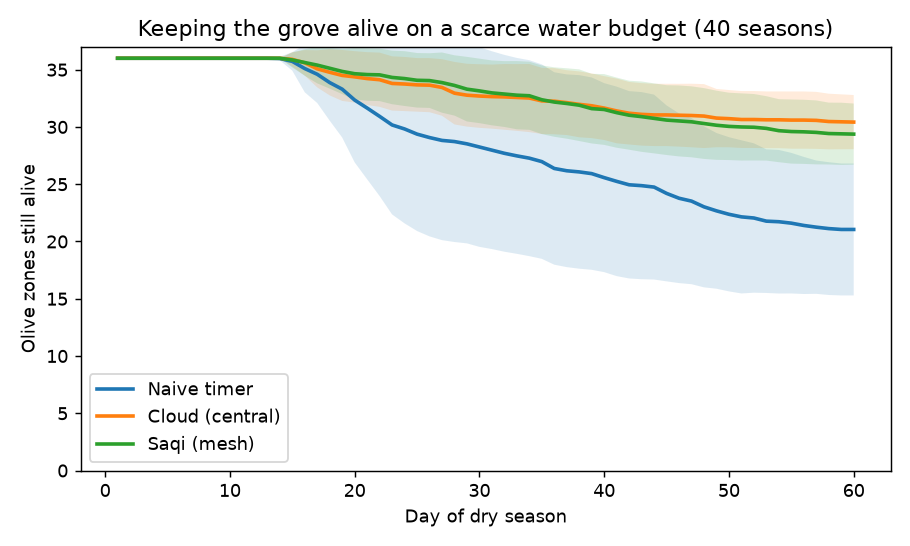
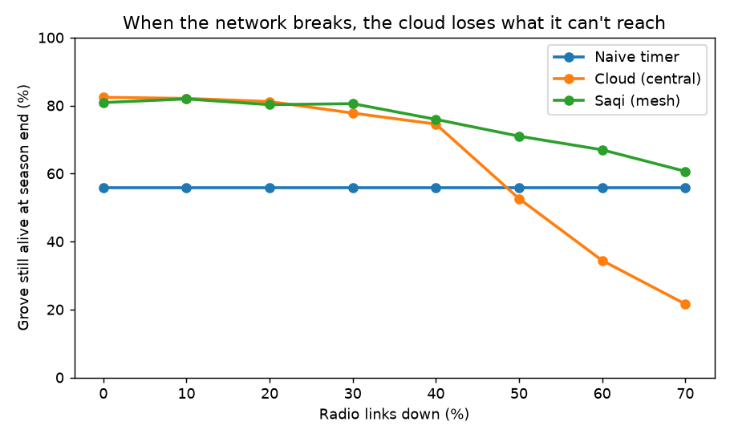
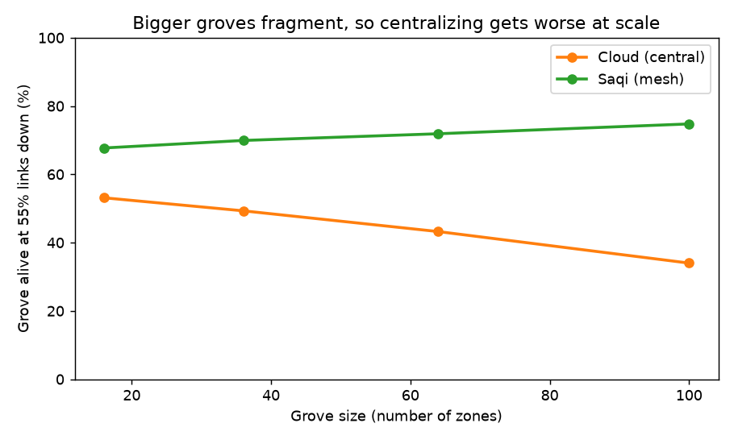
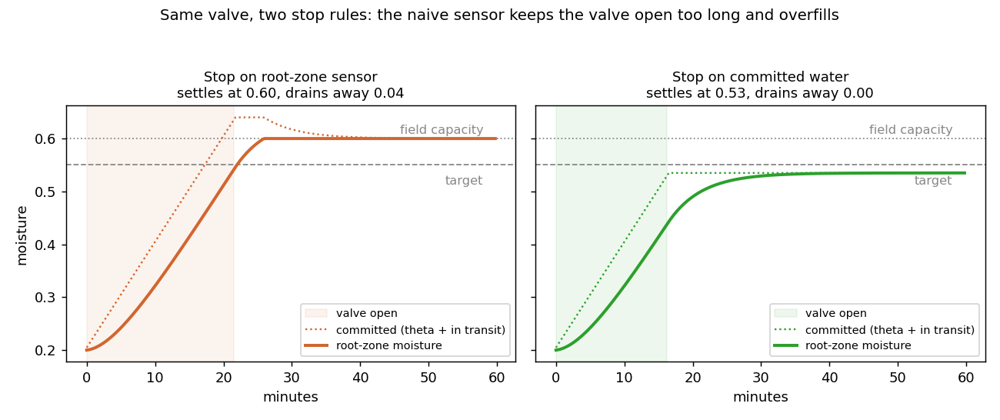
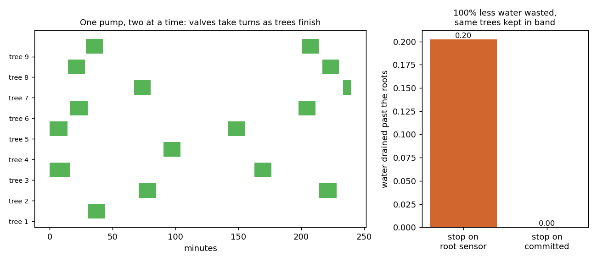

# Saqi

Decentralized, offline water-sharing for olive groves.

Saqi started in summer 2025, watching how my family's grove in Sidi Bouzid was
irrigated. This simulation of its allocation idea was built for the Moonshot 2026 hackathon
(Top 100). [Saqi v2](https://github.com/jjlalli/Saqi-v2) continues it: the same allocation
logic, re-aimed at zones and one controller, with a first field test.

The question behind it is simple: when a farm doesn't have enough water for every plant, who
gets it? The usual answer in "smart farming" is a cloud server that watches the whole farm and
decides. But I'm from an olive-farming family in Sidi Bouzid, Tunisia, and the tools I kept reading
about all assume Wi-Fi, grid power, and money, none of which our kind of farm has. So I wanted
to test the opposite idea: no server at all.

In Saqi, every zone of the grove runs a cheap device that only talks to the zones next to it.
They interact with each other until they agree on where the scarce water should go, keeping every
zone alive instead of spoiling a few. The whole thing works with no internet and no central
computer, and it keeps working even when parts of the network drop out.

## How it works

Each zone tracks its soil moisture. Every day there's a small shared water budget, never enough
for everyone. The goal is max-min: water the most desperate zones first, up to a safe line,
since olives survive on very little and the point is to lose nothing.

To decide that without any node seeing the whole farm, the nodes run average consensus (gossip):
each one repeatedly averages its water demand with its neighbours until the connected patch
agrees on a single cutoff. Everyone below the cutoff waters itself. If the network splits, each
piece just solves its own smaller version, which is the whole reason it survives failures.

## Results

I compare Saqi against a naive timer (equal split) and a "cloud" controller that sees everything
(the best you can do on the budget). Averaged over many random seasons:

- Connected: Saqi keeps about as many zones alive as the all-seeing cloud, both far above the
  timer.

  

- Network breaking: as radio links fail, the cloud collapses once it can't reach part of the
  farm, dropping below even the dumb timer, while Saqi degrades gently.

  

- Scale: in a broken network, bigger farms split into more islands, so the cloud gets worse as
  the farm grows and Saqi doesn't.

  

## From deciding to doing

The part above decides *who* gets water. Building toward real nodes raised the next question it
skipped: once a valve opens, when does it close? Water enters at the emitter and takes time to
reach the root zone, so the sensor lags. A node that waits until its probe reads the target
overshoots, because the water already in the soil keeps arriving after the valve shuts, and the
surplus drains past the roots and is wasted. The fix is to stop on *committed* water (moisture
already there plus water still in transit), which is what it means for a node to be smart: it has
to judge the whole root zone, not one lagging point. With a shared pump, a satisfied zone closes
its valve and signals done, freeing the pump for the next thirsty neighbour.





## Running it

```bash
pip install -r requirements.txt
python3 saqi.py          # the main comparison -> saqi_demo.png
python3 experiments.py   # resilience + scaling -> saqi_resilience.png, saqi_scaling.png
python3 control.py       # the watering loop -> saqi_control_stop.png, saqi_control_cluster.png
```

## What's in here

- `saqi.py`: the model and the three strategies (naive / cloud / Saqi)
- `experiments.py`: the resilience and scaling experiments
- `control.py`: the watering control loop (when to open and close each valve)
- `*.png`: the figures
- `Saqi Moonshot Paper.pdf`: the write-up (`.docx` source alongside)
- `Saqi_Vision_Pitch.pdf`: the Moonshot pitch deck

## Limitations

It's a simulation with a simple soil/weather model. The allocation tests the decision-making, not
the plumbing, and the control loop in `control.py` is a first pass at the watering itself with a
deliberately simple soil model. A real version would need cheap hardware, soil calibration (the
transit rate, field capacity, and drying come from real probes), and a season of field tests.
The hardware continues in Saqi v2.

## AI use

AI assistants helped write and debug the code and edit the write-up. The ideas are mine.

## License

MIT. See `LICENSE`.
